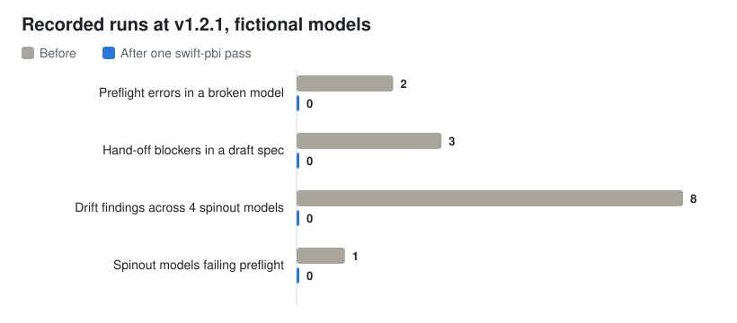

<h1 align="center">swift-pbi</h1>

<p align="center">
  
  
  
  
</p>

The people who know what a business should measure are rarely the people
who build the Power BI model. A marketing or operations team writes its
questions down, the request joins a data-engineering backlog, and weeks
later the first draft comes back shaped around what the engineers guessed.

Meanwhile, Power BI models have become code. PBIP and TMDL save a semantic
model as a folder of plain-text files you can keep in git, review and test.
**But the testing layer around those files is thin**, and the failures are
small, mechanical and expensive.

A table sits in `tables/` but has no `ref table` line in `model.tmdl`, so
tools that read the model's table list miss it. Someone copies a table and
its lineage tag comes along with it: that one stops Power BI Desktop opening
the project at all. A field-parameter row is deleted and its comma is left
behind: the model opens, but every visual on that field parameter fails. One
spinout model of the agency template gets a "quick fix" to a DAX measure, and
its revenue no longer matches every other spinout. A measure is renamed in the model,
and the chart still points at the old name.

None of these needs a redesign. Each one can cost an afternoon of clicking
through Desktop, or a number nobody trusts. And few tools check, before you
open Desktop, that a model will load at all: I tested each of these defects
on its own in Power BI Desktop, and only the duplicate lineage tag stopped
the project from opening at all.

**swift-pbi is the Power BI colleague in your terminal.** Business teams
describe their data and questions in conversation and get a model engineers
can open, with a hand-off package. Practitioners lint and fix TMDL, push a
template change to every spinout model without overwriting what each one is
meant to do differently, and keep every chart on one standardized canvas. Your agent runs four open-source
command-line tools, asks before it edits anything, and quotes every count
from what the tools printed.

<p align="center">
  <em>Describe it. Build it. Keep every copy in line.</em>
</p>

<p align="center">
  <picture>
    <source media="(prefers-color-scheme: dark)" srcset="assets/demo-hero-dark.svg">
    
  </picture>
</p>

<p align="center">
  <strong>A broken model: <!--PF_ERR_BEFORE-->3<!--/PF_ERR_BEFORE--> errors before, <!--PF_ERR_AFTER-->0<!--/PF_ERR_AFTER--> after one <code>fix</code>, each repair a one-line edit.</strong><br>
  <strong><!--CLIENTS-->4<!--/CLIENTS--> spinout models drifted from their template: <!--DRIFT_BEFORE-->6<!--/DRIFT_BEFORE--> findings before, <!--DRIFT_AFTER-->0<!--/DRIFT_AFTER--> after remediation.</strong><br>
  <sub>Every number is copied from <a href="benchmarks/demo/output/">recorded tool output</a> at v1.1.0 on macOS, re-run on 2026-10-18 with identical counts. All models and spinouts are fictional. <code>sh benchmarks/demo/run-all.sh</code> reproduces them.</sub>
</p>

The part I care most about is restraint. A measure that only one spinout has
is reported as an extension and never touched. A measure retired from the
template is removed from spinouts only after two separate yeses, and a
spinout that keeps it on purpose keeps it. The style findings that need a person to write
a description stay in the report instead of being papered over. The tools
fix what is mechanical and hand everything else back to you.

It works wherever your agent has a terminal: Claude Code, Codex, Cursor,
GitHub Copilot, Cline, Kiro, or anything that reads `AGENTS.md`. In Claude
chat and ChatGPT it can interview you, write the spec and explain pasted
output. Or skip the agent and run the four tools yourself. Personal project.

**Built for agencies.** If you report for many clients from one Power BI
template, each client gets a spinout model: same core measures, plus that
client's own sources, extensions and agreed exceptions. swift-pbi keeps every
spinout in line with the template without flattening those differences, and
keeps every report on the same canvas.

---

## Try it in a minute

You need [uv](https://docs.astral.sh/uv/). Lint the broken example, then fix
a copy (`fix` edits files in place):

```sh
git clone https://github.com/C-Kapsalis/swift-pbi && cd swift-pbi
cp -R examples/bike-shop-broken /tmp/bike-shop
uvx --from git+https://github.com/C-Kapsalis/tmdl-preflight@v1.1.0 tmdl-preflight check /tmp/bike-shop
uvx --from git+https://github.com/C-Kapsalis/tmdl-preflight@v1.1.0 tmdl-preflight fix /tmp/bike-shop
```

Or install the plugin and ask your agent: *"Lint the model in this folder and
tell me what blocks it from opening."*

## Before / after

[`examples/bike-shop-broken`](examples/) is a fictional bike shop's model
with four planted defects. Full run:
[01-preflight.txt](benchmarks/demo/output/01-preflight.txt).

**Before**, `tmdl-preflight check` (errors and warning only):

```
Metric Selector.tmdl:45  F001 error: stray comma run (1 orphan comma(s)) in calculated partition source (auto-fixable)
Stores.tmdl              M006 error: table 'Stores' is defined in tables/ but has no 'ref table' line in model.tmdl,
                         so it is not part of the model and Power BI will not open the project. (auto-fixable)
Stores.tmdl:3            M003 error: lineageTag 'e689596a-…' duplicates the one on table Products (Products.tmdl:3)
__Calendar.tmdl:4        M004 warning: lineageTag 'calendar-tag-TODO' is not a canonical UUID (auto-fixable)

tmdl-preflight: 3 error(s), 1 warning(s), 6 info(s)
```

That is the tool's own wording, and on one of those four lines it is wrong
about Desktop: M006 says the project will not open. The Windows test bench
([benchmarks/windows/RESULTS.md](benchmarks/windows/RESULTS.md)) ran each
defect on its own:

| Defect alone | What Desktop did |
|---|---|
| M003, the duplicate lineage tag | **refused to open** ("An object with lineage-tag '…' already exists") |
| M006, the missing `ref table` line | opened, and the table loaded with its relationship |
| M004, the placeholder lineage tag | opened |
| F001, the stray field-parameter comma | opened, but every visual on that field parameter failed |

So of the four lines above, only M003 blocks opening. M006 is a real defect
worth fixing (`model.tmdl` should list every table file, and tools that read
the table list from `model.tmdl` miss the table), but it does not stop
Desktop. The preflight skill says the same thing and tells the agent to
block only on M003.

The block above is the pinned `v1.1.0` output, so it carries the old M006
wording and the old severities (M006 as an error). The tool on `master`
already prints the corrected message and M006 as a warning; the pins switch
to that tag in one commit when the owner cuts it.

**The fix**, `tmdl-preflight fix`, after your agent has asked:

```
fixed  M006: model.tmdl: + ref table Stores
fixed  M003: Stores.tmdl:3 (table Stores): 'e689596a-…' -> 'af0fb374-…'
fixed  M004: __Calendar.tmdl:4 (table __Calendar): 'calendar-tag-TODO' -> '5fb432bd-…'
fixed  F001: Metric Selector.tmdl: removed 1 orphan comma(s) from 'Metric Selector' partition source
```

**After**, an independent re-check:

```
tmdl-preflight: 0 error(s), 0 warning(s), 6 info(s)
```

<!--PF_FILES-->4<!--/PF_FILES--> files changed, one line each. The 6 infos
are missing descriptions and a missing format string: a person should write
those, so no fixer touches them. A second `fix` changes nothing.

## What it does

| Skill | Does | Tool (v1.1.0) |
|---|---|---|
| `prototype-model` | Interview, spec, build, validate, hand-off package | [pbip-model-forge], [tmdl-preflight] |
| `preflight` | Lint, explain findings, fix with consent, re-check | [tmdl-preflight] |
| `fleet-drift` | Template vs spinout models: detect, classify, remediate with an allowlist; deletions double-gated | [tmdl-drift-doctor] |
| `chart-style` | Keeps every report on one [standardized canvas](https://c-kapsalis.github.io/projects/pbi-plot-styler.html): combo charts driven by field parameters and bookmarks, styled from the model; catches broken bindings and bookmarks | [pbi-plot-styler] |
| `power-bi-definitions` | Reuse and audit a model's measures when a dashboard must match Power BI | (reads the TMDL; no tool needed) |

[tmdl-preflight]: https://github.com/C-Kapsalis/tmdl-preflight
[pbip-model-forge]: https://github.com/C-Kapsalis/pbip-model-forge
[tmdl-drift-doctor]: https://github.com/C-Kapsalis/tmdl-drift-doctor
[pbi-plot-styler]: https://github.com/C-Kapsalis/pbi-plot-styler

**For business teams.** Describe what you need to answer and where the data
lives today. The agent asks at most three questions per turn, draws a star
schema, writes a spec, builds a PBIP with fictional sample rows, and checks
it. You hand the engineers a model they can open plus `HANDOFF.md`: your
questions mapped to measures, the diagram, every table, column and measure,
and the open questions only they can answer (source of truth, refresh,
history, row-level security).

**For practitioners.** 114 lint rules on TMDL, 22 of them with a mechanical
fixer, plus `baseline`, GitHub and SARIF output and a pre-commit hook for CI.
(Those are the counts the final tools print on their `master` branch. The
pinned v1.1.0 release the skills install still carries the earlier 37 rules
and 10 fixers; the pins switch to the new tag in one commit when the owner
cuts it.) Spinout models kept in line with one template, with an
allowlist of what may be auto-fixed and a ledger of what was retired. Reports
built on one standardized canvas: a single combo-chart page driven by three
field parameters (plot axis, legend, measures) and bookmarks that each answer
one recurring question, restyled from the model so a new metric comes out
deck-ready. The approach, and a live demo, are on
[my site](https://c-kapsalis.github.io/projects/documenting-bi-reports-for-marketers.html).

**What counts as an intended difference.** A spinout is allowed to differ
from the template, and `fleet.yml` says exactly how:

| A spinout that... | Is kept by | So remediation... |
|---|---|---|
| has its own measures or columns | nothing to configure: reported as `extra.*` | never edits or deletes them |
| has tables the template does not | nothing to configure | does not treat them as drift |
| uses its own data source or connection parameters | leaving them off `allowlist.expressions` | never cascades them; only the shared parameters you list move |
| calculates a measure its own way, or sets a different format, folder or relationship | an `override` with `kind: expression`, a reason, an owner and a date | acknowledges it and lists it in `review` |
| deliberately lacks a table, column, measure or relationship | an `override` with `kind: absent` (an absent table covers its relationships) | does not re-add it |
| keeps an object the template retired | an `override` with `kind: retain`, or `ledger --revive` | does not remove it, even with `--sync` |
| is still being onboarded | `gating: advisory` | reports drift without failing CI |

Anything else is drift. Only the kinds you list in `allowlist.kinds` are
ever fixed automatically, and an override that names an object the template
never had is an error, so stale exceptions cannot pile up.

The skills run each tool with
`uvx --from git+https://github.com/C-Kapsalis/<tool>@v1.1.0 <command>`, so
nothing is installed globally and every run uses the same tagged release.

## How it works

1. **The tools decide, the agent explains.** Every count in a reply is copied
   from tool output. The agent never estimates a result.
2. **Dry run, then a yes.** `fix`, `build`, `remediate` and `style` change
   files, so the agent shows a dry run or diff first and waits for consent.
3. **No hand edits to pass a check.** A failing model is fixed by changing the
   spec and rebuilding, or by a fixer doing the mechanical repair.
4. **Honest about Desktop.** Passing the validators is not the same as opening
   in Power BI Desktop. The agent never claims the second unless you did it.
5. **Fictional sample data.** Real records, client names and account ids never
   go into a spec.

The rules live in [`AGENTS.md`](AGENTS.md); each skill is in
[`skills/`](skills/).

## Demo: real runs at v1.1.0

Every number below is copied from
[benchmarks/demo/output/](benchmarks/demo/output/), recorded on 2026-10-17 on
macOS and re-run on 2026-10-18 with identical counts.
`sh benchmarks/demo/run-all.sh` reproduces them, and
`python3 benchmarks/demo/hero.py` redraws the chart and refills the numbers in
this README from that output. All models and spinouts are fictional.

**Lint and fix** ([output](benchmarks/demo/output/01-preflight.txt)). On
`bike-shop-broken`, tmdl-preflight reported <!--PF_FINDINGS-->10<!--/PF_FINDINGS-->
findings: 3 errors (M006, M003, F001), 1 warning (M004) and 6 infos (S001,
S002 x5). `fix` applied <!--PF_FIXES-->4<!--/PF_FIXES--> fixes. The re-check found 0 errors and 0 warnings.

**A model from a spec** ([output](benchmarks/demo/output/02-forge.txt)). A
first-draft spec for a bike repair workshop failed the hand-off profile with
0 P0 and <!--FORGE_P1_BEFORE-->3<!--/FORGE_P1_BEFORE--> P1: an orphan customer
key (FM005), a per-customer ratio counted from the dimension instead of the
fact (FM015), and a measure with no description (FM017). The corrected spec
passed with 0 P0, <!--FORGE_P1_AFTER-->0<!--/FORGE_P1_AFTER--> P1, 0 P2. The
build passed tmdl-preflight with 0 errors, 0 warnings, 0 infos (6 tables, 29
columns, 6 measures, 4 relationships) and wrote `handoff/SPEC.md` with a
Mermaid diagram. Rebuilding gave byte-identical files.

**One template, four spinout models** ([output](benchmarks/demo/output/03-drift.txt)).
Planted drift: changed DAX, a lost currency format, a deleted measure, a
dropped column, a relationship switched to both directions, a measure moved
to another table, and one spinout-only measure. Before remediation,
tmdl-preflight found 1 error in one spinout (a field parameter pointing at the
deleted measure). `detect` found 6 actionable findings and 1 advisory.
`remediate` applied <!--DRIFT_APPLIED-->6<!--/DRIFT_APPLIED--> and skipped
the advisory one; afterwards `detect` reported 0 actionable and
tmdl-preflight 0 errors in all four spinouts. Then I retired a measure from
the template: `detect` refused to run on the stale baseline; after recapture,
`remediate` without `--sync` removed nothing (4 skipped); one spinout was
marked as keeping the measure; `--sync` removed it from the other 3. `audit`
checked 6 applied fixes, 6 still in place.

**Chart style** ([output](benchmarks/demo/output/04-plot-styler.txt)). On the
coffee-roastery example shipped with pbi-plot-styler, `check` found 0 errors;
`style` restyled 1 of 1 combo chart from 6 measures; a second run restyled 0.
After I renamed one measure in the model only, `check` reported 2 errors
(BND001, BND002) naming the visual that still pointed at the old name.

## How it compares

These tools are mature and widely used, and swift-pbi does not replace them.
This is how I understand each from its own documentation; corrections are
welcome.

| | Lint model files | Auto-fix | Model from a spec | Template to many spinouts | Report checks | Deploys |
|---|---|---|---|---|---|---|
| [Tabular Editor](https://github.com/TabularEditor/TabularEditor) Best Practice Analyzer | Yes, rich rule sets on model metadata | Many rules, via fix scripts | No | No | No | Not covered here |
| [ALM Toolkit](https://github.com/microsoft/Analysis-Services/tree/master/AlmToolkit) | No | No | No | Compare and merge two models at a time, TMDL included | No | Metadata-only deploys |
| [PBI Inspector / Fab Inspector](https://github.com/NatVanG/fab-inspector) | Report and Fabric items, declarative JSON rules | No | No | No | Yes, PBIR | No |
| [fabric-cicd](https://github.com/microsoft/fabric-cicd), [Fabric CLI](https://github.com/microsoft/fabric-cli) | No | No | No | No | No | Yes, git to Fabric workspaces |
| swift-pbi (four tools) | Yes, 114 rules on TMDL files (22 with a fixer) | 22 mechanical fixers, 3 of them unsafe | Yes, with sample data and a hand-off pack | Yes: detect, allowlist, ledger, double-gated deletion | Combo-chart bindings, bookmarks, canvas conventions, styling | No |

Where swift-pbi is weaker: Tabular Editor's rule sets are larger and far more
widely used; ALM Toolkit compares and deploys to live models; Fab Inspector
covers far more of the report layer; fabric-cicd and the Fabric CLI deploy,
which swift-pbi does not do at all. A reasonable setup uses swift-pbi in git
before a deployment tool takes over.

## Install

**Claude Code** (or the Code tab of Claude Desktop), as two prompts:

```
/plugin marketplace add C-Kapsalis/swift-pbi
```
```
/plugin install swift-pbi@swift-pbi
```

You also need [uv](https://docs.astral.sh/uv/) for `uvx`. Then open a folder
with a `.pbip` and ask: "Lint this model", "Prototype a model for our
support tickets", or "Check the spinout models against the template".

**Codex, Cursor, Copilot, Cline, Kiro, Claude chat and ChatGPT:** step by
step in [INSTALL.md](INSTALL.md), with what I have and have not tested.

## Limits

- **A local shell is required to run the tools.** Claude Code, the Code tab
  in Claude Desktop, Codex, or an IDE agent with a terminal. In claude.ai chat
  and ChatGPT the skills can interview, write a spec and explain pasted
  output, but cannot run the tools.
- **"Opens in Power BI Desktop" is verified by the validator, not by Desktop.**
  The demo script runs on macOS, where Power BI Desktop does not run, so the
  recorded demo output is not a Desktop open-test. I did run a separate
  Windows bench on 2026-10-18
  ([benchmarks/windows/RESULTS.md](benchmarks/windows/RESULTS.md)): every
  model the demo produced was opened in Power BI Desktop, and each planted
  defect was tested on its own. That bench found one case where the tool and
  Desktop disagree, and it is written up in the "Before / after" section
  above. Opening any other `.pbip` is still a manual step on Windows, and the
  skills say so in every hand-off.
- **macOS and Windows.** The demo script ran on macOS; the Windows bench ran
  the same commands through Git Bash. The tools are Python and document
  Windows use; the demo scripts are POSIX `sh` and need Git Bash or WSL on
  Windows.
- **Right files, not right numbers.** A clean lint says the model is
  structurally sound, not that a measure means what the business means. The
  forge checks catch some grain mistakes; the rest is review.
- **The skills are benchmarked, and the effect is small.** The demo tests the
  tools. What the skills do to an agent is measured separately
  ([method](benchmarks/METHOD.md), [results](benchmarks/results/eval-runs.json)):
  across 37 case-runs the plugin arm scored 0.90 against 0.84 without it,
  and the per-suite mean delta was positive in four runs out of five
  (median +0.05). The plugin's value is narrow and real — the agent quotes
  the tool's counts, asks before it edits, and says which finding Desktop
  actually blocks — and it is not a licence to let a model loose on a real
  model. The suite is also the first step of a
  [complexity ladder](benchmarks/LADDER.md): four rungs of growing model
  size, so the question "does this hold as the model grows?" can be asked
  as a measurement rather than a belief.

Found a model that trips a rule it should not, or slips past one it should
catch? [Open an issue](https://github.com/C-Kapsalis/swift-pbi/issues) or see
[CONTRIBUTING.md](CONTRIBUTING.md). Real-world counterexamples, with the
data made fictional, are the most useful.

## Credits

The tools build on Microsoft's PBIP and TMDL formats. The comparison above
credits Tabular Editor (Daniel Otykier and contributors), ALM Toolkit
(Christian Wade and Microsoft), PBI Inspector and Fab Inspector (Nat Van
Gulck), and Microsoft's fabric-cicd and Fabric CLI teams, whose work shaped how
I think about testing Power BI models. Documentation follows
[Diataxis](https://diataxis.fr) by Daniele Procida.

Personal project; not affiliated with my employer or any client. Example
models and spinouts are fictional.

## License

[MIT](LICENSE).
